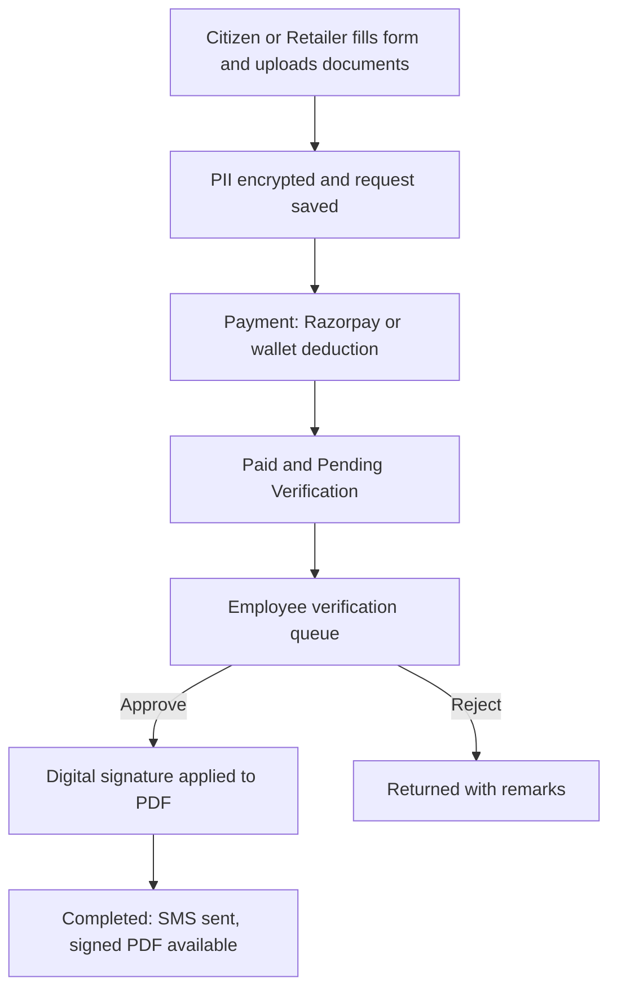

# LabourSeva: Project Master Document

<aside>
📌

**LabourSeva** is a multi-tenant e-service delivery platform connecting citizens, retail Kendra operators, distributors, verification employees and administrators. This page consolidates the whole plan: stack, portals, features, security, employee module, Cloudflare setup, design, build phases and open items. Status: **planning, not yet built**. Last updated 2026-10-10.

</aside>

---

## 1. Project overview

- **Goal:** a full-stack website for a government-related initiative with fee registration, payment processing, referral programs, SMS notifications and email communication, hosted on Hostinger.
- **Language and runtime:** Node.js (TypeScript), explicitly not PHP.
- **Hierarchy:** Superadmin, then Distributors, then Retailers, then Customers. Employees handle verification, queries and IAM. Guests apply without an account.
- **Economy:** prepaid wallets. Distributors fund retailers, retailers pay for citizen applications from their wallet, and commissions flow up the hierarchy.
- **Dynamic forms:** application forms render at runtime from database-defined service schemas, so new services launch without code changes.

## 2. Technology stack

| Layer | Choice | Why |
| --- | --- | --- |
| App | Next.js (TypeScript), frontend and API routes | One codebase, SSR, easy to maintain |
| Database | MySQL (Hostinger) with Prisma ORM | Runs on the same server, parameterized queries by default |
| Auth | Mobile OTP for citizens; password plus OTP or TOTP for staff roles | Workers mostly use phones |
| Payments | Razorpay (PayU optional behind the same interface) | UPI, cards, netbanking, webhooks, refunds |
| SMS | Existing gateway (My Dreams Technology), server-side only | OTP and transactional messages; DLT-registered templates required in India |
| Email | `no-reply@labourseva.com` via SES or Brevo SMTP | OTP, receipts, notices; SPF, DKIM and DMARC configured |
| Edge | Cloudflare (proxy, WAF, Turnstile, Access) | DDoS protection, bot control, admin allowlisting |
| Hosting | Hostinger Node.js hosting (Business or Cloud) or a VPS | Shared plans without Node will not work |

## 3. Roles and portals

Each portal has its own login, its own session store and secret, and a host-only cookie (`__Host-` prefix, `Secure`, `HttpOnly`, `SameSite=Strict`; Lax for the customer site).

| Portal | URL | Cookie | Session TTL | Extra protection |
| --- | --- | --- | --- | --- |
| Public and Customer | `labourseva.com` | `__Host-ls_cust` | 7 days | OTP login |
| Admin | `admin.labourseva.com/dash` | `__Host-ls_admin` | 30 min idle | Password, TOTP 2FA, Cloudflare Access |
| Distributor | `distributors.labourseva.com/s/dash/<random>` | `__Host-ls_dist` | 2 hours | Password plus OTP |
| Retailer (proposed URL) | `retailer.labourseva.com/...` | `__Host-ls_ret` | 2 hours | Password plus OTP |
| Employee (proposed URL) | `staff.labourseva.com/...` | `__Host-ls_emp` | 1 hour | Password plus 2FA, Cloudflare Access |
| Guest | `labourseva.com/guest` | `__Host-ls_guest` | 30 min | Reference ID plus OTP |
- Session tokens are random 256-bit values; only the hash is stored, so a single session can be revoked and the active sessions manager works.
- Middleware checks hostname plus role on every request, so a valid distributor session never works on an admin URL.
- The random path segment is only obscurity. Real protection comes from 2FA, Cloudflare Access and lockouts. Rotate the random value per distributor.

## 4. Feature modules

### Public portal

Landing page, service catalog, schemes, notices, feedback, grievance and contact forms, partner and franchise info, careers, downloads, help desk, multi-step registration with SMS OTP, Turnstile, legal pages (privacy, terms, refund, compliance), English and Tamil.

### Citizen portal

Registration, OTP login and recovery, dashboard, e-service browsing, dynamic application forms, document vault, Razorpay payments with receipts, active sessions manager, help desk tickets.

### Guest portal

One-time application forms, direct checkout, status tracking by reference ID plus phone OTP.

### Retailer (Kendra) desk

Wallet dashboard, assisted-application wizard (fee deducted from wallet), status monitor, ledger, printable receipts, referral program.

### Distributor hub

Mandatory KYC, retailer onboarding, wallet top-up through the gateway, commission breakdowns and reports.

### Administration suite

Dashboard, user management and approval queues, service catalog (categories, services, fees, required documents, field schemas), request desk, wallet and commission rules, payment audit, master data (district, taluk, panchayath), content management, analytics, reports, backups, settings.

## 5. Application workflow



## 6. Employee module

The employee portal is the internal operations hub with three queues: **Verification**, **Query desk** and **IAM**. Employees have no access to wallet or payment administration.

- **Verification and signing:** applicant data beside the document viewer, checklist, approve or reject with mandatory remarks, canvas-based signing preview, server-side signature application, then automatic SMS.
- **Query desk:** feedback, grievances, contact and help-desk requests, and advertise, careers and partner inquiries. Each gets a reference ID, an age timer and an SLA flag, and closes with a recorded resolution and SMS or email notification.
- **IAM:** KYC review, account activate, suspend or flag, session oversight and revocation, access request processing, recovery supervision, anomaly flagging.

**Recommended tightening**

- Employees may approve, suspend or revoke only customers, retailers and distributors. Suspending staff or admins and changing roles is admin-only.
- Maker-checker: a second approver for reactivating a suspended distributor or any decision that changes wallet-linked access.
- Personal data is masked by default; decrypting a value is a per-record action that logs who revealed what.
- The signing key stays server-side (KMS or HSM-backed); signed PDFs are immutable with a recorded hash.

## 7. Security and data protection

- **Encryption:** AES-256-GCM for personal data fields, with key versions and a key store separate from the data. HMAC blind indexes for searchable fields such as phone numbers. Store only the last 4 digits of Aadhaar.
- **Passwords:** argon2id. OTPs are stored hashed, limited to 5 attempts, with per-number and per-IP rate limits.
- **Documents:** stored outside any public path, encrypted at rest, with randomized filenames. Allow only PDF, JPG and PNG verified by magic bytes, with a size limit. Serve only through an authenticated endpoint that issues a short-lived signed token (2 to 5 minutes), checks ownership or role, and writes an audit-log row. Forced download headers, no directory listing.
- **Malware scanning:** needs ClamAV, which means a VPS. On shared hosting use strict content checks, re-encode images, or call a scanning API.
- **Web security:** parameterized queries, output escaping, CSRF tokens, request validation (Zod), rate limiting, Turnstile, CSP, HSTS and frame restrictions in middleware, generic error pages, no decrypted personal data in logs.
- **Payments:** server-computed amounts, Razorpay signature verification, webhooks as the source of truth, idempotency keys, wallet deductions inside DB transactions with row locks.
- **Audit:** immutable logs for logins, document access, dispositions, signatures, wallet adjustments, payment callbacks, IAM decisions and admin changes, each with identity, timestamp and reason.
- **Compliance:** DPDP Act 2023 consent capture, privacy policy and deletion process; retention rules per document category; encrypted offsite backups with the key kept separate.
- **Incident response:** compromised accounts get session revocation, suspension and credential reset; suspected file exposure gets token invalidation and access-log review; payment anomalies go to a manual verification queue.

## 8. SMS and email

- **SMS gateway:** My Dreams Technology API, sender ID `MDTDMO`, app name `labourseva.com`. Called from the server only.
- **OTP template:** must match the DLT-registered text exactly. The current text reads "Dear {otp}" and says valid for 30 minutes. The plan is to enforce a 5-minute expiry in code and re-register the template to match.
- **Email:** `no-reply@labourseva.com` for OTP and notices, with a separate monitored address such as `support@` for replies.
- **Queue:** SMS and email go through a background queue (BullMQ with Redis, or a DB-backed queue on shared hosting) with delivery-status callbacks and retries.

## 9. Cloudflare setup

- Proxy all subdomains, set SSL to Full (strict), enable HSTS.
- Allow only Cloudflare IPs at the origin and use authenticated origin pulls where Hostinger allows it.
- Managed WAF rules plus stricter rate limits on login, OTP and register endpoints.
- Turnstile on registration, login and OTP request forms.
- Cloudflare Access on `admin.` and `staff.` with an email or IP allowlist before the login page loads.
- Bypass cache for dashboards and API routes.
- Add SPF, DKIM and DMARC DNS records for the no-reply address.
- Keep the Razorpay webhook route reachable without Access; the app verifies the signature.
- Tooling already installed in this workspace: Cloudflare plugin and the `cf` CLI (beta). Run `cf auth login` yourself to authorize your account.

## 10. Payments, wallet and referrals

- **Registration fee:** order created server-side, paid through Razorpay, activated by webhook, receipt PDF emailed.
- **Wallet:** every credit and debit is a ledger row; deductions use row locks so a retailer cannot double-spend.
- **Commissions:** a rule table splits each paid application across distributor and retailer, with payout logs.
- **Referrals:** each user gets a unique code; a referral counts only after the referred user completes payment. Rules: no self-referral, one mobile number per account, limits per user.

## 11. Design tokens (from the TNeGA file)

Use the visual tokens only. Do not use TNeGA's name, emblem or layout; if LabourSeva is not officially authorized as a Tamil Nadu government service, look-alike styling could be read as impersonation. Use LabourSeva's own logo and wording.

| Token | Value | Role |
| --- | --- | --- |
| Primary blue | `#1D3F8F` | Primary accent |
| Text dark | `#0C0A09` | Primary text |
| Text mid | `#4E4E4E` | Primary text |
| Text muted | `#777169` | Secondary text |
| Border | `#E7E5E4` | Borders |
| Surface | `#D6D3D1` | Surfaces |
| Background | `#F5F5F5`, `#FFFFFF` | Page backgrounds |

Typography is Noto Sans (covers Tamil). Spacing uses a 4px base scale, cards a 16px radius, buttons a pill radius.

## 12. Data model (core tables)

`users`, `profiles`, `documents`, `sessions_<role>` (one store per portal), `otp_codes`, `applications`, `service_schemas`, `payments`, `payment_events`, `wallet_ledger`, `commission_rules`, `referrals`, `tickets`, `iam_requests`, `notifications`, `announcements`, `audit_logs`, `settings`, plus master data for district, taluk and panchayath.

## 13. Repository structure

```
labourseva/
  apps/web      (public, customer, guest)
  apps/admin    (admin and employee)
  apps/partner  (distributor, retailer, agent)
  packages/db       (Prisma schema)
  packages/auth     (per-role session logic)
  packages/crypto   (AES-GCM, blind index)
  packages/notify   (SMS, email)
  packages/pay      (Razorpay, wallet ledger)
```

If the Hostinger plan allows only one Node app, run a single app with hostname-based routing instead.

## 14. Deployment on Hostinger

1. Push to GitHub and connect it to Hostinger's Node.js app for build on push.
2. Create the MySQL database and connect to `127.0.0.1:3306`.
3. Set environment variables (Razorpay keys, SMS and email keys, DB URL, session and encryption secrets). Never commit them.
4. Run `prisma migrate deploy` and set the webhook URL in Razorpay.
5. Point the domain through Cloudflare and enable SSL.

## 15. Build phases

- [ ]  Foundation: project setup, DB schema, per-role sessions, OTP auth, admin login
- [ ]  Registration and payments: fee flow, webhooks, receipts
- [ ]  Notifications: SMS and email templates, queue, logs
- [ ]  Wallet, retailer and distributor flows, commissions
- [ ]  Employee desk: verification, signing, query desk, IAM
- [ ]  Referrals and reports
- [ ]  Admin suite: catalog, content, analytics, exports
- [ ]  Hardening: security review, load test, backups, go-live

## 16. Open items and risks

- [ ]  **Rotate the SMS API key.** It was pasted into a chat, so treat it as exposed and request a new one from the provider.
- [ ]  Ask the SMS provider for an `https://` endpoint; the current URL is `http://`.
- [ ]  Re-register the OTP DLT template so the text and validity period match.
- [ ]  Confirm how many Node apps the Hostinger plan allows (decides one app versus separate portals).
- [ ]  Confirm VPS versus shared hosting (needed for ClamAV malware scanning).
- [ ]  Confirm the registration fee amount and the payment gateway (Razorpay assumed).
- [ ]  Confirm official authorization status before using any government branding.
- [ ]  Decide final URLs for the retailer, employee and agent portals.

---

## 17. Master to-do: everything to do, in steps

### Step 1: Accounts and decisions (before any code)

- [ ]  Rotate the SMS API key with the provider and request an `https://` endpoint
- [ ]  Re-register the OTP DLT template so the text and validity (5 minutes) match
- [ ]  Confirm the Hostinger plan: Node.js app count, MySQL, VPS or shared
- [ ]  Confirm the registration fee amount and the payment gateway (Razorpay assumed)
- [ ]  Create the Razorpay account and complete KYC, then get test and live keys
- [ ]  Confirm official authorization status before using any government branding
- [ ]  Decide final URLs for the retailer, employee and agent portals
- [ ]  Prepare the LabourSeva logo and wording (no TNeGA name or emblem)

### Step 2: Domain, Cloudflare and email

- [ ]  Add `labourseva.com` to Cloudflare and switch the nameservers
- [ ]  Create the subdomains: `admin`, `distributors`, `retailer`, `staff`
- [ ]  Set SSL to Full (strict) and enable HSTS
- [ ]  Run `cf auth login` and reload plugins in your agent
- [ ]  Set up the `no-reply@labourseva.com` mailbox or SMTP provider (SES or Brevo)
- [ ]  Add SPF, DKIM and DMARC DNS records and send a test email
- [ ]  Create Turnstile site keys for the public forms
- [ ]  Put `admin.` and `staff.` behind Cloudflare Access with an allowlist
- [ ]  Add WAF managed rules and rate limits for login, OTP and register

### Step 3: Project setup

- [ ]  Create the GitHub repository and the monorepo structure
- [ ]  Set up Next.js (TypeScript), Prisma, Zod, ESLint and the shared packages
- [ ]  Apply the theme tokens (Noto Sans, `#1D3F8F` palette, 4px spacing) and English and Tamil i18n
- [ ]  Create the Hostinger MySQL database and connect through `127.0.0.1:3306`
- [ ]  Add environment variables in Hostinger (keys, DB URL, session and encryption secrets); nothing in git
- [ ]  Set up the CI build and auto-deploy from GitHub

### Step 4: Database and security foundation

- [ ]  Write the Prisma schema for all core tables and run the first migration
- [ ]  Build the AES-256-GCM module with key versions and HMAC blind indexes
- [ ]  Build per-role session logic: separate cookies, tables, secrets and TTLs
- [ ]  Add hostname plus role middleware, CSRF protection and security headers (CSP, HSTS)
- [ ]  Build the audit log utility and the rate limiter
- [ ]  Hash passwords with argon2id

### Step 5: Authentication and notifications

- [ ]  Build the SMS module for the gateway, called server-side only
- [ ]  Build OTP: hashed storage, 5-minute expiry, 5 attempts, per-number and per-IP limits
- [ ]  Build login, registration and recovery for each portal
- [ ]  Add TOTP 2FA for admin and employee accounts
- [ ]  Build email templates and the background queue with delivery logs and retries
- [ ]  Add Turnstile verification to the public forms

### Step 6: Payments and wallet

- [ ]  Build the `PaymentProvider` interface and the Razorpay order flow
- [ ]  Build the webhook endpoint with signature verification and idempotency
- [ ]  Build the wallet ledger with transactional deductions and row locks
- [ ]  Build distributor wallet top-up, retailer funding and commission rules
- [ ]  Generate receipts as PDFs
- [ ]  Test payment success, failure, duplicate webhook and refund cases

### Step 7: Citizen, guest, retailer and distributor portals

- [ ]  Build the public pages, service catalog and legal pages
- [ ]  Build the dynamic form engine from service schemas
- [ ]  Build the document vault with magic-byte checks and encrypted storage
- [ ]  Build the tokenized document viewer (2 to 5 minute tokens, ownership checks, access logging)
- [ ]  Build the citizen dashboard, application tracking and sessions manager
- [ ]  Build the guest flow: checkout and reference ID plus OTP tracking
- [ ]  Build the retailer desk: assisted-application wizard, ledger, receipts, referrals
- [ ]  Build the distributor hub: KYC, retailer onboarding, commissions and reports
- [ ]  Build the referral program with anti-fraud rules

### Step 8: Employee and admin

- [ ]  Build the employee queues: Verification, Query desk and IAM
- [ ]  Build the review screen with masked personal data and logged reveals
- [ ]  Build the server-side signing flow and store signed PDFs as immutable with a hash
- [ ]  Build the ticket system with reference IDs, age timers and SLA flags
- [ ]  Build the IAM actions with the scope limits and maker-checker approvals
- [ ]  Build the admin suite: users, catalog, requests, wallets, payment audit, master data, content, reports, backups

### Step 9: Testing and hardening

- [ ]  Test role isolation: no cookie or session works across portals
- [ ]  Test OTP abuse, brute force, CSRF and injection attempts
- [ ]  Test file upload abuse and document token expiry
- [ ]  Confirm no decrypted personal data appears in logs or errors
- [ ]  Add malware scanning (ClamAV on a VPS, or a scanning API)
- [ ]  Load test the main flows and check Cloudflare caching rules
- [ ]  Review DPDP Act items: consent capture, privacy policy, deletion process

### Step 10: Go-live

- [ ]  Switch Razorpay to live keys and set the live webhook URL
- [ ]  Set up encrypted offsite backups and test a restore
- [ ]  Confirm the SMS template and sender are approved on DLT
- [ ]  Remove test data and create the real admin and employee accounts
- [ ]  Turn on monitoring and alerts for failed logins, payments and queue errors
- [ ]  Final walkthrough of each portal, then launch